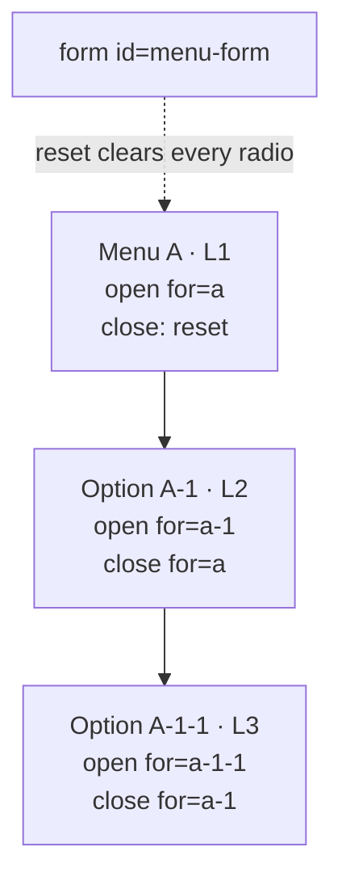

# pure-css-nested-menu

A branching menu at any depth, where **exactly one path is open at a time**. Three CSS rules, no JavaScript required.

Close a level and everything beneath it closes with it; its ancestors stay open; nothing re-opens behind your back.

---

## Contents

- [Features](#features)
- [Optional JavaScript](#optional-javascript)
- [Quick start](#quick-start)
- [Markup contract](#markup-contract)
- [Missing-module failsafe](#missing-module-failsafe)
- [How it works](#how-it-works)
- [Notes and constraints](#notes-and-constraints)
- [Browser support](#browser-support)
- [Files](#files)

---

## Features

- **Three rules.** Depth and branching are markup, never CSS. Add a sibling or nest another level by pasting one `.node` block.
- **One open path.** Every radio in a tree shares one `name`, so the browser guarantees at most one is ever checked.
- **No ghost re-opens.** Closing a level genuinely unchecks everything below it.
- **No build, no dependencies.** One stylesheet. The optional script is the only other file.
- **Presentation stays yours.** The engine hides the radio and flips `display` on the two faces and the panel. Size, colour, spacing and motion are not in it.
- **Many menus per page.** One `<form>` and one radio `name` per tree; they never interfere.
- **Safe fallback if the stylesheet is missing.** Adding `hidden` to radios, `.close` faces, and `.panel` containers keeps the menu collapsed to its top-level `.open` headers when the CSS cannot be reached, so page layout stays intact.

## Optional JavaScript

The menu works without any script. [`assets/pure-css-nested-menu.js`](assets/pure-css-nested-menu.js) is supplemental: it adds what the markup cannot say to assistive technology, reading state from the radio group without ever writing or mutating it.

It adds:

- `role="button"` and `tabindex="0"` on `.open` and `.close` `<label>` faces (labels are not focusable or keyboard-pressable on their own; root `<button type="reset">` elements already are and keep their native button identity)
- `aria-expanded` on both faces, computed with the same subtree check as the CSS (`input[type=radio]:checked` anywhere inside `.node`)
- `aria-controls` linking each face to its `.panel` (generating `nested-menu-panel-N` ids only when a panel has no `id`, and preserving any author-supplied `role`, `tabindex`, or `aria-controls`)
- Enter and Space activation on the faces

Load it once after the markup or with `defer`; it is safe to include twice (guarded by `window.pureCssNestedMenu.loaded`). It re-syncs on `change`, on `reset` (deferred via `queueMicrotask` so the browser clears the radios first), and on `DOMContentLoaded`, and exposes `window.pureCssNestedMenu.sync()` for nodes added later.

Without it: the menu still opens, closes and resets with a pointer, and the radios remain keyboard-operable through the group. What is lost is the announced state and Enter/Space on the faces.

## Quick start

1. Link [`assets/pure-css-nested-menu.css`](assets/pure-css-nested-menu.css) once.
2. Add one empty external `<form>` per menu tree, with a unique `id`. It is a form owner only: it renders nothing.
3. Write the markup below. Every radio and the root reset join that form with `form="…"`.
4. Optionally add the script from [Optional JavaScript](#optional-javascript).

```html
<form id="menu-form"></form>
```

## Markup contract

```
.node
├─ input[type="radio"]      the state carrier (name + form)
├─ label.open[for="self"]   open this node
├─ label.close[for="parent"] close it to its parent
└─ .panel                   children container
   └─ .node                 …same structure, any number, any depth
```

| Element / class | Role | Requirement |
| --- | --- | --- |
| `<form id="…">` | form owner | One per tree, empty, never nested |
| `.node` | one menu item | Wraps a radio, its two faces, its children |
| `input[type="radio"]` | state | Direct child of `.node`; one `name` and one `form` shared across the tree (add `hidden` for the failsafe) |
| `.open` | open face | `<label for="this-id">` |
| `.close` | close face | `<label for="parent-id">`; at the root, `<button type="reset" form="…">` (add `hidden` for the failsafe) |
| `.panel` | children container | Direct child of `.node`, after the faces (add `hidden` for the failsafe) |

The faces and the panel must be **direct children** of `.node`, because the engine selects them with `>`.

### Repeatable node template

Every node below the root is the same block. Change the ids, the label text, and paste children into `.panel`:

```html
<div class="node">
  <input type="radio" name="menu" id="r-self" form="menu-form" hidden>
  <label for="r-self" class="open">Node title</label>
  <label for="r-parent" class="close" hidden>Node title</label>
  <div class="panel" hidden>
    <!-- any number of child .node blocks -->
  </div>
</div>
```

A root node is the same block with the close face swapped for a reset control bound to the form:

```html
<div class="node">
  <input type="radio" name="menu" id="r-root" form="menu-form" hidden>
  <label for="r-root" class="open">Menu</label>
  <button type="reset" form="menu-form" class="close" hidden>Menu</button>
  <div class="panel" hidden>…</div>
</div>
```

## Missing-module failsafe

If the stylesheet fails to load or is removed, every hidden radio button, every duplicate `.close` control, and every nested `.panel` at every depth would render open at once and blow out surrounding page layout. Add the HTML `hidden` attribute directly in markup on those three elements so the menu collapses cleanly to its top-level `.open` headers — no JavaScript needed:

- **Radios:** `<input type="radio" … hidden>`
- **Close faces:** `<button type="reset" class="close" … hidden>` and `<label class="close" … hidden>`
- **Panels:** `<div class="panel" hidden>`

```html
<div class="node">
  <input type="radio" name="menu" id="a" form="menu-form" hidden>
  <label for="a" class="open">Open Menu A</label>
  <button type="reset" form="menu-form" class="close" hidden>Close Menu A</button>
  <div class="panel" hidden>
    <div class="node">
      <input type="radio" name="menu" id="a-1" form="menu-form" hidden>
      <label for="a-1" class="open">Open Option A-1</label>
      <label for="a" class="close" hidden>Close Option A-1</label>
      <div class="panel" hidden>…</div>
    </div>
  </div>
</div>
```

**How it behaves in both states:**

- **Stylesheet missing or unreachable:** The browser's user-agent `[hidden] { display: none; }` removes every radio, `.close` face, and `.panel` from layout. Only the top-level `.open` labels remain visible so the rest of the page is not pushed out of place (clicking them will not expand the menu while the CSS is missing).
- **Stylesheet loaded:** Author rules automatically override user-agent `[hidden]`: `.node > input[type=radio]` restores `display: block` (keeping radios keyboard-focusable while visually hidden via `opacity: 0; pointer-events: none`), and `.node:has(input[type=radio]:checked) > :is(.close, .panel)` sets `display: block` whenever a node opens.

> Avoid `style="display: none"` on radios, `.close`, or `.panel` — inline styles out-specify the stylesheet and would keep them permanently hidden. In host page CSS, also avoid setting `display` on `.close` or `.panel` (which would override `[hidden]` even when the module is missing); setting `display: block` on `.open` alone is safe so `<label class="open">` keeps block width if the module fails to load.

## How it works

**One group, one checked node.** Every radio in a tree shares a single `name`, so radio exclusivity does the bookkeeping. There is never a second checked node to clean up.

**Open is derived, not stored.** A node is open when anything inside it is checked:

```css
.node:has(input[type="radio"]:checked)
```

That matches the node's own radio and every radio deeper in its subtree, so the ancestors of the active node open themselves and nothing else does.

**Closing a level checks its parent.** While a node is closed its row shows `.open`, pointing at itself. While it is open the row shows `.close`, pointing at the parent's radio. Pressing it checks the parent, which unchecks the whole subtree below, and the ancestors stay open because their radios are on the path.

**The root resets.** A root `.close` is `type="reset"` in the same form, so it clears the tree's radios in one press instead of merely selecting the root.

### The engine

[`assets/pure-css-nested-menu.css`](assets/pure-css-nested-menu.css) ships comment-free and tab-indented in three rules total:

```css
.node > input[type=radio] {
	display: block;
	position: absolute;
	opacity: 0;
	pointer-events: none;
}

.node > :is(.close, .panel),
.node:has(input[type=radio]:checked) > .open { display: none; }

.node > .open,
.node:has(input[type=radio]:checked) > :is(.close, .panel) { display: block; }
```

1. **Rule 1** overrides `hidden` with `display: block` and visually hides the radios (`opacity: 0; pointer-events: none`) without breaking label activation, keyboard focus, or form reset.
2. **Rule 2** hides `.close` and `.panel` while a node is closed, and hides `.open` once any radio inside `.node` is checked.
3. **Rule 3** shows `.open` while closed, and reveals `.close` and `.panel` once checked (the `:has(...)` selectors carry higher specificity than the closed defaults, so depth and branching stay purely in markup).

### How interactions behave

A three-level example: `A` → `A-1` → `A-1-1`, with siblings at every level.

| Action | Control pressed | Checked after | Open path |
| --- | --- | --- | --- |
| Page load | none | *(none)* | Closed |
| Open A, then A-1 | `label[for="a"]`, `label[for="a-1"]` | `a-1` | A → A-1 |
| Open A-1-1 | `label[for="a-1-1"]` | `a-1-1` | A → A-1 → A-1-1 |
| Switch to sibling A-2 | `label[for="a-2"]` | `a-2` | A → A-2 *(A-1 subtree closes)* |
| Close A-1 | `label[for="a"]` | `a` | A |
| Reopen A-1 | `label[for="a-1"]` | `a-1` | A → A-1 *(children stay closed)* |
| Switch to root B | `label[for="b"]` | `b` | B *(A subtree closes)* |
| Close the menu | root reset | *(none)* | Closed |

### Constant size

The wiring is the same at every level: `.open` points one step down, `.close` points one step up, and the root's close points at a reset.



So the CSS never grows:

| Task | Change | New CSS |
| --- | --- | :---: |
| Add a sibling at any depth | Paste one `.node` into the parent `.panel` | **0 lines** |
| Add a fifth, tenth, Nth level | Nest one `.node` in the level above | **0 lines** |
| Add a second, independent menu | New `<form id>` and a new radio `name` | **0 lines** |

## Notes and constraints

- **Ids are per page.** Every `for=`/`id=` pair must be unique, so two menus never share ids.
- **`close` points at the direct parent.** Point it one level too high and the press skips a level; point it at itself and the press does nothing.
- **The root's close must be a reset.** A label cannot clear a subtree; `type="reset"` bound to the form can.
- **One radio name per tree.** Two names means one radio can be checked in each; the two groups then open independently, which is only right if they are two menus.
- **Closed panels take no space.** The engine uses `display`, so a closed node leaves layout. If you need closed panels measurable for height animation or anchor positioning, that is a different engine.
- **The radios stay focusable.** They are visually hidden, not `disabled`, so the group is keyboard-operable. The optional script is what makes the faces themselves pressable.
- **When pruned.** With the `hidden` failsafe in place (see [Missing-module failsafe](#missing-module-failsafe)), removing the stylesheet leaves compact collapsed top-level `.open` headers instead of expanding the full tree; without `hidden`, the raw radios, labels, and reset buttons still toggle state unstyled.

## Browser support

- `:has()`: Chrome 105+, Edge 105+, Safari 15.4+, Firefox 121+.
- No JavaScript is required for the menu to work.
- The optional script needs nothing beyond ES2021 (`??=`, `||=`; Chrome 85+, Edge 85+, Safari 14+, Firefox 79+).

## Files

```
modules/pure-css-nested-menu/
├── readme.md
├── assets/
│   ├── pure-css-nested-menu.css           required
│   └── pure-css-nested-menu.js            optional, accessibility
└── examples/
    ├── abc.html                           3 menus, 5 levels, links both files
    └── example-assets/
        ├── pure-css-nested-menu.css       local module copy for standalone examples
        └── pure-css-nested-menu.js        local optional script copy for standalone examples
```
