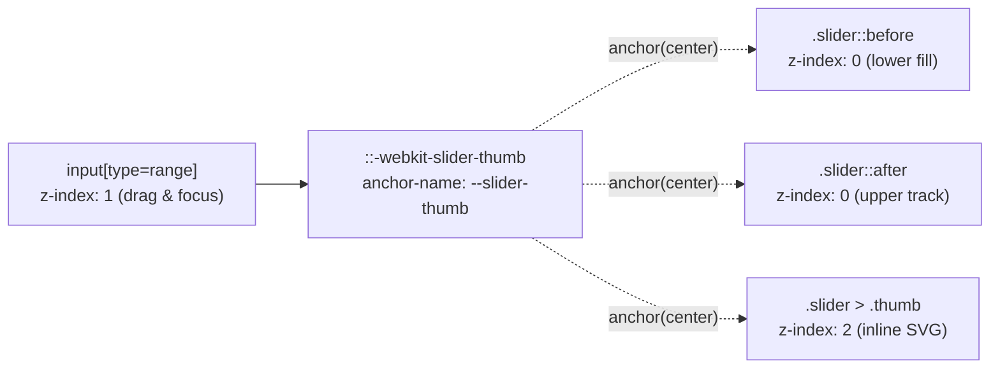

# range-slider-style

Style a native `<input type="range">` with **any inline SVG as the thumb** and a **split lower/upper track fill** — pure CSS, zero JavaScript required.

The thumb's center can travel all the way to the outer edges of the track without scaling hacks, `overflow: hidden` clipping, or losing native dragging and keyboard control.

---

## Contents

- [Features](#features)
- [Quick start](#quick-start)
- [Markup contract](#markup-contract)
- [Missing-module failsafe](#missing-module-failsafe)
- [How it works](#how-it-works)
- [Notes and constraints](#notes-and-constraints)
- [Browser support](#browser-support)
- [Files](#files)

---

## Features

- **Any SVG or element as the thumb.** Drop an inline `<svg class="thumb">` inside `.slider` — circular, angular, non-square, or offset. It reads `:root` CSS variables directly and animates with normal CSS transitions and `@keyframes`.
- **True split track fill, no `overflow: hidden`.** `::before` paints the filled lower side and `::after` paints the unfilled upper side, both anchored to the thumb's dead center. Because nothing clips the slider, taller or overhanging thumbs never get cut off.
- **Exact edge-to-edge travel.** One token (`--slider-inset`) picks whether the thumb's center stops at the outer track edges, the rounded pill endcap centers, or flush inside.
- **Native control stays in charge.** `<input type="range">` keeps its native value, `min`/`max`/`step`, pointer drag (including the full overhanging thumb area), keyboard stepping, `disabled`, `dir="rtl"`, and form submission.
- **Many sliders per page.** `anchor-scope: --slider-thumb` isolates each `.slider` wrapper, so unlimited sliders share one stylesheet with zero id wiring or extra CSS.
- **Safe fallback if the stylesheet is missing.** Marking `.thumb` with `display="none"` (SVG) or `hidden` (HTML) keeps custom thumbs out of layout when the CSS cannot be reached, leaving default native sliders intact.
- **Engine and paint separated.** Layout and anchoring come first in the stylesheet; minimal default colours sit in the second half and can be overridden with tokens or dropped altogether.
- **No build, no dependencies, no JavaScript.** One stylesheet, no scripts, and no external fonts, icons, or images.

## Quick start

1. Link [`assets/range-slider-style.css`](assets/range-slider-style.css) once.
2. Wrap a native `<input type="range">` in `.slider`.
3. Optionally place any inline `<svg class="thumb" display="none" aria-hidden="true">` as a direct child of `.slider` (`display="none"` keeps the SVG out of layout if the stylesheet is absent; the module reveals it with `display: block`).
4. Tune size, travel inset, and colours with `--slider-*` tokens (inline or in your own stylesheet).

```html
<span class="slider" style="--slider-thumb: 24px; --slider-fill-color: #6366f1;">
  <input type="range" min="0" max="100" value="50" aria-label="Volume">
  <svg class="thumb" viewBox="0 0 24 24" display="none" aria-hidden="true">
    <circle cx="12" cy="12" r="9" fill="#ffffff" stroke="#6366f1" stroke-width="3"/>
  </svg>
</span>
```

## Markup contract

```
.slider
├─ input[type="range"]            the native control (state, drag, keyboard, form)
└─ .thumb   (optional, e.g. svg)  visual thumb anchored to the native thumb's center
```

| Element / class | Role | Requirement |
| --- | --- | --- |
| `.slider` | wrapper & visible track box | Holds the track height, `anchor-scope`, and `::before` / `::after` fill layers |
| `input[type="range"]` | state & interaction | Direct child of `.slider`; native attributes (`min`, `max`, `step`, `value`, `disabled`, `aria-label`) live here |
| `.thumb` | custom visual thumb | Optional direct child of `.slider` (typically `<svg display="none" aria-hidden="true">`, or an HTML element with `hidden`); rendered above `<input>` with `display: block` and `pointer-events: none` |

`input[type="range"]` and `.thumb` must be **direct children** of `.slider`, because the engine selects them with `>`.

If `.thumb` is omitted, the default paint renders a plain circle on the native thumb while keeping the anchored split track fill.

### Tokens

Set any of these on `.slider` (inline or via a class):

| Token | Default | Purpose |
| --- | --- | --- |
| `--slider-track` | `6px` | Track thickness (`block-size`) |
| `--slider-thumb` | `24px` | Thumb inline size (hit-box & `.thumb` width) |
| `--slider-thumb-block` | `var(--slider-thumb)` | Thumb block size for non-square handles (e.g. an audio fader) |
| `--slider-inset` | `0px` | Distance from each track end where the thumb's center stops (see [Edge travel modes](#edge-travel-modes)) |
| `--slider-radius` | `999px` | Track corner radius (inherited by `::before` and `::after` outer ends) |
| `--slider-track-color` | `transparent` | Base background behind `::before` and `::after` |
| `--slider-fill-color` | `#3b82f6` | Lower / filled track colour (`.slider::before`) |
| `--slider-rest-color` | `#d1d5db` | Upper / unfilled track colour (`.slider::after`) |

## Missing-module failsafe

If the stylesheet fails to load or is removed, an unstyled inline `<svg class="thumb">` (or HTML `.thumb`) would render at full size beside the range input and disrupt page layout. Hide `.thumb` directly in markup so it stays out of flow until the module loads — no JavaScript needed:

- **Inline `<svg>` thumb:** add the SVG presentation attribute `display="none"`.
- **HTML element thumb:** add the `hidden` attribute.

```html
<!-- Inline SVG thumb -->
<span class="slider">
  <input type="range" min="0" max="100" value="50" aria-label="Volume">
  <svg class="thumb" viewBox="0 0 24 24" display="none" aria-hidden="true">
    <circle cx="12" cy="12" r="9" fill="#ffffff" stroke="#6366f1" stroke-width="3"/>
  </svg>
</span>

<!-- HTML element thumb -->
<span class="slider">
  <input type="range" min="0" max="100" value="50" aria-label="Volume">
  <span class="thumb" hidden aria-hidden="true"></span>
</span>
```

**How it behaves in both states:**

- **Stylesheet missing or unreachable:** `.thumb` stays completely out of layout (`display="none"` on SVG, browser `[hidden] { display: none; }` on HTML), and `<span class="slider">` wraps transparently around the native `<input type="range">`, which loads as a default browser slider without affecting the rest of the page.
- **Stylesheet loaded:** SVG presentation attributes have specificity `0,0,0` and `[hidden]` sits in the user-agent stylesheet, so the module's `.slider > .thumb { display: block; }` automatically overrides both and reveals the custom thumb.

> Do not use `style="display: none"` on `.thumb` — an inline style overrides the stylesheet and would keep the thumb hidden even when the module loads.

## How it works

### Decoupling the visible track from the travel rail

Browsers always clamp `::-webkit-slider-thumb`'s border-box strictly inside `::-webkit-slider-runnable-track`'s content-box, so a normal thumb's center can never get closer than half its own width to either end of the track.

To break that coupling without scaling the thumb:

1. **`.slider` wears the visible track** (`[0, W]`), while `<input>` and `::-webkit-slider-runnable-track` are transparent.
2. **`::-webkit-slider-runnable-track` outsets outward** by `--slider-overhang` on both ends using `flex: 1; inline-size: auto; margin-inline: calc(var(--slider-overhang) * -1);`.
3. Because the native thumb still has its real layout width (`--slider-thumb`), its center travels cleanly across `[--slider-inset, W - --slider-inset]`, and pointer clicks map 1:1 with zero drift.
4. **`.slider` reserves `margin-inline: max(0px, var(--slider-overhang))`** so overhanging thumb halves do not crowd neighbouring flex or inline items.

### Edge travel modes

`--slider-overhang` is derived automatically from `--slider-thumb` and `--slider-inset`:

```css
--slider-overhang: calc(var(--slider-thumb) / 2 - var(--slider-inset));
```

| `--slider-inset` | Thumb center at `min` / `max` | Overhang past track | Use when |
| --- | --- | --- | --- |
| `0px` *(default)* | Exact outer left (`0`) and right (`W`) edges of `.slider` | `thumb / 2` | Edge-to-edge alignment, sharp tracks, pointers, crosshairs |
| `calc(var(--slider-track) / 2)` | Exact centers of the rounded pill endcaps | `(thumb - track) / 2` | Pill tracks where the thumb should nest concentrically on the rounded ends |
| `calc(var(--slider-thumb) / 2)` | `thumb / 2` inside each edge (outer thumb edges sit flush with the track) | `0px` | Classic contained slider with zero horizontal bleed |

```
--slider-inset: 0px                       (center hits outer track edges)
      ╭───╮                                                           ╭───╮
      │ ● ├───[===========================|===========================]───┤ ● │
      ╰───╯   ^                                                       ^   ╰───╯
            x = 0                                                   x = W

--slider-inset: calc(var(--slider-track) / 2)   (center hits pill endcap centers)
          ╭───╮                                                   ╭───╮
        [═│ ● │===========================|=======================│ ● │═]
          ╰───╯                                                   ╰───╯

--slider-inset: calc(var(--slider-thumb) / 2)   (thumb stays flush inside track)
        ╭───╮                                                       ╭───╮
        │ ● │=============================|=========================│ ● │
        ╰───╯                                                       ╰───╯
```

### Split track and anchored custom thumb

The native thumb stays invisible (when `.thumb` is present) at full `--slider-thumb` × `--slider-thumb-block` hit-test size and publishes its box as `anchor-name: --slider-thumb`:



- **`.slider::before`** spans `inset-inline-start: 0` to `inset-inline-end: anchor(center)` (inheriting the start corner radii from `.slider`, falling back to `calc(100% - var(--slider-fill, 0%))`).
- **`.slider::after`** spans `inset-inline-start: anchor(center)` to `inset-inline-end: 0` (inheriting the end corner radii from `.slider`, falling back to `var(--slider-fill, 0%)`).
- **`.slider > .thumb`** uses physical `top: anchor(center, 50%)` and `left: anchor(center, var(--slider-fill, 50%))` with `translate: -50% -50%` so it stays dead-center in both `dir="ltr"` and `dir="rtl"` without flipping the translate sign. `pointer-events: none` forwards clicks and drags straight to the native thumb underneath, and `overflow: visible` prevents scaled SVG strokes from clipping at any page zoom.
- **Hover and drag styling** target `.slider:is(:hover, :has(> input:active)) > .thumb` so an animated SVG stays in its active state even if the pointer drifts off the track mid-drag.

### Engine vs. default paint

[`assets/range-slider-style.css`](assets/range-slider-style.css) ships comment-free and tab-indented for minimum size, split cleanly into two halves:

1. **Engine (top half, through `.slider > .thumb`):** sets geometry defaults (`--slider-track`, `--slider-thumb`, `--slider-thumb-block`, `--slider-inset`, `--slider-overhang`), `anchor-scope`, the transparent outset travel rail, the full-size transparent native thumb (`background: none`, `anchor-name: --slider-thumb`), the anchored `::before` / `::after` split layers, and `.slider > .thumb` positioning (`display: block` reveals thumbs marked `display="none"` or `hidden`).
2. **Default paint (bottom half, from the second `.slider` rule onward):** sets `--slider-radius`, `--slider-track-color`, `--slider-fill-color`, and `--slider-rest-color`; paints a minimal circle fallback on the native thumb when `.thumb` is omitted (`.slider:not(:has(> .thumb))`); moves the `:focus-visible` outline from `<input>` onto `.slider` (`outline-offset: 4px`); and dims `:disabled` sliders (`opacity: 0.45`, `cursor: not-allowed`). A host can override the tokens or drop the second half entirely and still have a working control.

## Notes and constraints

- **Keep units on `--slider-inset`.** Always pass a length (`0px`, not bare `0`) — it is used inside `calc(var(--slider-thumb) / 2 - var(--slider-inset))` and `max(0px, var(--slider-overhang))`, where a unitless `0` invalidates the expression.
- **Vendor pseudo-elements are intentionally separate.** `::-webkit-slider-*` and `::-moz-range-*` live in separate rules because browsers drop an entire selector list if any pseudo-element in it is unknown.
- **Anchor isolation is built in.** `.slider` sets `anchor-scope: --slider-thumb`, so multiple sliders on the same page never collide — even side by side in the same flex row.
- **Keep animated properties out of inline `style="..."`.** Inline styles out-specify stylesheet rules, so if a `.thumb` animates `fill`, `stroke`, or `transform` on `:hover` / `:active`, keep those base properties in a `<style>` block (static tokens like `--slider-*`, `transform-origin`, and `transition` can stay inline).
- **Use explicit `viewBox` coordinates for `transform-origin`.** On SVG shapes inside `.thumb`, `transform-origin: 12px 12px` (for a `24×24` viewBox) is consistent across engines where `transform-box: fill-box` can differ on stroked paths.
- **Asymmetric thumbs.** Override `translate` on `.slider > .thumb` (for example `translate: -50% -78%` for a teardrop pin pointing at the track) without changing the track's travel math.
- **Non-square thumbs.** Set both `--slider-thumb` (width) and `--slider-thumb-block` (height) so the native hit-test area matches the visible SVG.
- **Even pixel parity prevents subpixel wobble.** Choosing even values for both `--slider-track` and `--slider-thumb` (such as `6px` and `24px` or `28px`) makes `(track - thumb) / 2` an exact integer vertically and horizontally.

## Browser support

- **Requires:** CSS Anchor Positioning (`anchor-name`, `anchor-scope`, `position-anchor`, `anchor()`) on range thumb pseudo-elements, and `:has()`.
- **Chromium (Chrome 125+, Edge 125+, Electron):** Full pure-CSS support — split track fill, edge-to-edge travel, and anchored inline SVG thumbs work with zero JavaScript.
- **Safari / Firefox:** Both ship CSS Anchor Positioning (Safari 26+, Firefox 147+), but resolving or invalidating `anchor-name` from inside a range input's user-agent shadow DOM is not yet interoperable across all versions. On engines that do not resolve it, `anchor()` falls back to `--slider-fill` (`0%` on the track split and `50%` on `.thumb` if unset), and the native range input remains usable.
- **No JavaScript is required.**

## Files

```
modules/range-slider-style/
├── readme.md
├── assets/
│   └── range-slider-style.css             required (engine + default paint)
└── examples/
    ├── basic.html                         default, disabled, and RTL arrow
    ├── reuse-thumb.html                   shared --slider-thumb anchor isolation
    ├── complex.html                       animated SVG thumbs (ring-dot, diamond, fader, pin)
    ├── contained-thumb.html               full-height tracks with flush-inside thumbs
    └── example-assets/
        └── range-slider-style.css         local module copy for standalone examples
```
